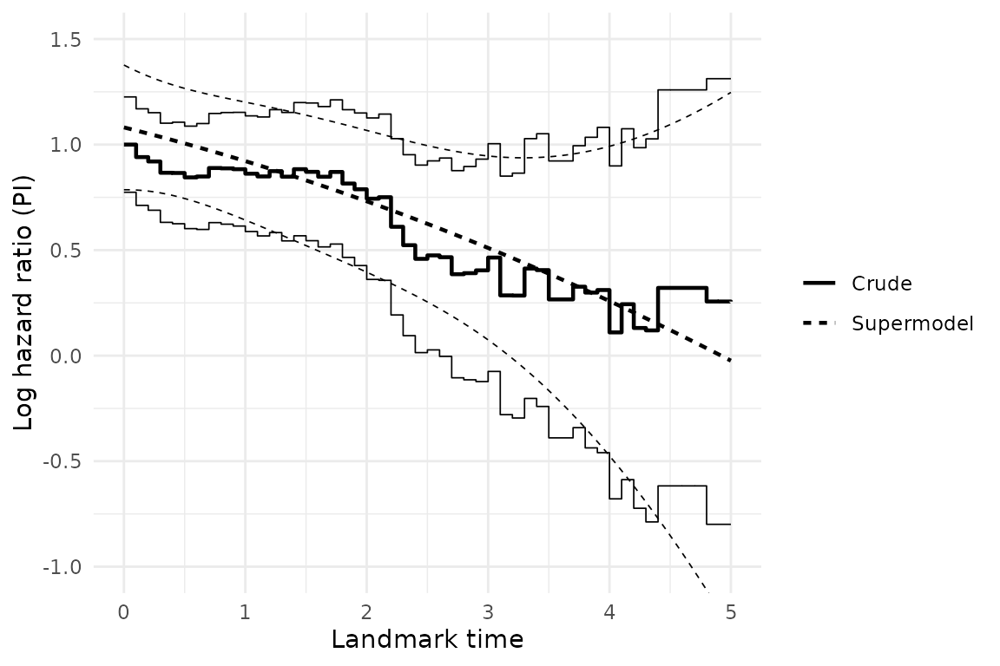

# Superlandmarking with static covariates

``` r

library(landmaRk)
library(survival)
```

## Overview

This vignette fits both a basic landmarking model and a superlandmarking
model to a cohort of ovarian cancer patients, the dataset `ova` (see
[`?ova`](https://vallejosgroup.github.io/landmaRk/reference/ova.md)).
The example is taken from Section 7.2 (“Obtaining dynamic predictions by
landmarking”) of van Houwelingen HC, Putter H (2012), *Dynamic
Prediction in Clinical Survival Analysis*.

Landmarking produces a prediction from landmark time \\s\\ up to horizon
\\s + w\\ by fitting a survival (typically Cox) model to the risk set
still at risk at \\s\\. Optionally, the dataset is administratively
censored at \\s + w\\. \\ h(t \mid x, s, w) = h_0(t \mid s, w)
\exp(x^\top \beta\_{LM}), \qquad s \le t \le s + w. \\ Repeating this at
a grid of landmark times \\s_1, \dots, s_L\\ gives landmark-specific
estimate of \\\beta\_{LM}\\ per landmark (the “Crude” estimates below).

Superlandmarking instead pools every landmark-specific dataset into a
single stacked superdataset, and lets \\\beta\_{LM}\\ vary smoothly with
\\s\\ via a basis expansion rather than being re-estimated independently
at each landmark: \\ h(t \mid x, s, w) = h_0(t \mid s, w) \exp\\x^\top
\beta\_{LM}(s)\\, \qquad s \le t \le s + w, \\ \\ \beta\_{LM}(s) =
\sum\_{j=1}^{m_b} \gamma_j f_j(s). \\ Fitting this is a single Cox model
stratified on \\s\\ (giving every landmark its own baseline hazard
\\h_0(t \mid s, w)\\) with covariate \\\times f_j(s)\\ interaction terms
for \\\hat\gamma\\ — exactly what the `formula` argument of
[`fit_superlandmark()`](https://vallejosgroup.github.io/landmaRk/reference/fit_superlandmark.md)
specifies directly, via `strata(LM)` and `covariate:f_j(LM)` terms.

The stratified baseline \\h_0(t \mid s, w)\\ is only defined at the
landmark times actually used for fitting. Instead, the following
equation lets a single baseline hazard vary smoothly with \\s\\ too: \\
h_0(t \mid s, w) = h_0(t) \exp\\\theta(s)\\, \qquad \theta(s) =
\sum\_{j=1}^{m_h} \eta_j g_j(s), \\ for basis functions \\g_j\\
standardized so that \\g_j(s_1) = 0\\.

The outcome of interest is overall survival. Following Section 7.2 of
van Houwelingen and Putter, the predictor is a single prognostic index
summarizing a patient’s clinical risk factors at baseline, and the
prediction window is \\w = 3\\ years following each landmark time. The
superlandmarking approach is used because the proportional hazard
assumption does not hold here.

## Example: ovarian cancer dataset

``` r

data(ova)
str(ova)
#> 'data.frame':    358 obs. of  8 variables:
#>  $ tyears : num  0.967 2.666 1.055 0.682 4.721 ...
#>  $ d      : num  1 1 1 1 1 1 1 0 1 0 ...
#>  $ Karn   : num  9 10 10 9 10 8 10 10 7 10 ...
#>  $ Broders: Factor w/ 5 levels "1","2","3","4",..: 5 4 3 2 2 3 3 1 4 1 ...
#>  $ FIGO   : Factor w/ 2 levels "III","IV": 2 2 1 1 1 1 2 1 2 1 ...
#>  $ Ascites: Factor w/ 3 levels "absent","present",..: 2 2 2 2 3 2 3 1 1 1 ...
#>  $ Diam   : Factor w/ 5 levels "micr.","<1cm",..: 3 2 3 5 5 5 4 5 5 4 ...
#>  $ id     : int  1 2 3 4 5 6 7 8 9 10 ...
```

`ova` contains 358 patients from two clinical trials of combination
chemotherapy for advanced ovarian cancer (Neijt et al. 1984, 1987).
Every column other than the outcome and patient identifier is a baseline
covariate recorded once, at diagnosis:

- `tyears`: time in years from diagnosis to death or last follow-up (the
  survival outcome’s time).
- `d`: event indicator, `1` = death, `0` = censored (the survival
  outcome’s status).
- `Karn`: Karnofsky performance score at diagnosis, recoded from 6
  (\\\le 60\\) to 10 (100); higher is better.
- `Broders`: Broders’ histological tumour grade, a factor with levels
  `"1"`-`"4"` and `"unknown"`.
- `FIGO`: FIGO disease stage at diagnosis, a factor with levels `"III"`
  and `"IV"`.
- `Ascites`: presence of ascites at diagnosis, a factor with levels
  `"absent"`, `"present"`, `"unknown"`.
- `Diam`: diameter of the residual tumour after surgery, a factor with
  levels `"micr."`, `"<1cm"`, `"1-2cm"`, `"2-5cm"`, `">5cm"`.
- `id`: patient identifier.

There is no time-varying (longitudinal) covariate in this data set.

## Static Cox model

``` r

fit_baseline <- coxph(
  Surv(tyears, d) ~ FIGO + Diam + Broders + Ascites + Karn,
  data = ova
)
coef(summary(fit_baseline))
#>                      coef exp(coef)   se(coef)          z    Pr(>|z|)
#> FIGOIV          0.5035526 1.6545890 0.13628834  3.6947596 0.000220095
#> Diam<1cm        0.2466117 1.2796822 0.32279108  0.7639980 0.444868449
#> Diam1-2cm       0.6650962 1.9446776 0.32615708  2.0391899 0.041431080
#> Diam2-5cm       0.7845449 2.1914095 0.31486141  2.4917151 0.012712797
#> Diam>5cm        0.8361761 2.3075264 0.30389497  2.7515299 0.005931760
#> Broders2        0.5726751 1.7730037 0.24329916  2.3537899 0.018583114
#> Broders3        0.5200791 1.6821607 0.23442502  2.2185307 0.026518672
#> Broders4        0.3232976 1.3816765 0.27435834  1.1783771 0.238646301
#> Brodersunknown  0.6502278 1.9159773 0.26458607  2.4575286 0.013989668
#> Ascitespresent  0.2715428 1.3119870 0.15527944  1.7487361 0.080336647
#> Ascitesunknown  0.2054579 1.2280872 0.21279951  0.9654997 0.334294588
#> Karn           -0.1732264 0.8409472 0.05395007 -3.2108656 0.001323358
```

The fitted (centered) linear predictor of this static Cox model
(prognostic index) is used to inform the landmarking and
superlandmarking models.

``` r

lp <- predict(fit_baseline, type = "lp")
ova$PI <- lp - mean(lp)
c(mean = mean(ova$PI), sd = sd(ova$PI))
#>          mean            sd 
#> -7.690234e-17  5.911247e-01
```

## Setting up the landmark analysis

`PI` is a single, time-fixed covariate (computed once from baseline
data), so this analysis does not require a longitudinal submodel.
[`LandmarkAnalysis()`](https://vallejosgroup.github.io/landmaRk/reference/LandmarkAnalysis.md)
still requires `data_dynamic` to be a named list of data frames, so an
empty placeholder is supplied.

``` r

x <- LandmarkAnalysis(
  data_static = ova,
  data_dynamic = list(
    none = data.frame(id = integer(0), time = numeric(0), value = numeric(0))
  ),
  event_indicator = "d",
  ids = "id",
  event_time = "tyears",
  times = "time",
  measurements = "value"
)
```

Following van Houwelingen and Putter (2012), landmark times are chosen
on an equidistant grid from \\s_1 = 0\\ to \\s_L = 5\\ years with
distance 0.1, with a fixed prediction window \\w = 3\\ years.

``` r

sL <- 5
w <- 3
landmarks <- seq(0, sL, by = 0.1)
x <- compute_risk_sets(x, landmarks)
```

## Crude landmarking

A separate Cox model is fitted at each landmark time, using
[`fit_survival()`](https://vallejosgroup.github.io/landmaRk/reference/fit_survival.md).

``` r

x <- fit_survival(
  x,
  formula = Surv(event_time, event_status) ~ PI,
  landmarks = landmarks,
  horizons = landmarks + w,
  method = "coxph"
)

# One fit per landmark, e.g. at s = 0:
coef(summary(x@survival_fits[["0-3"]]))
#>    coef exp(coef)  se(coef)        z     Pr(>|z|)
#> PI    1  2.718282 0.1152429 8.677325 4.051874e-18
```

## Superlandmarking

A single Cox supermodel is fitted using
[`fit_superlandmark()`](https://vallejosgroup.github.io/landmaRk/reference/fit_superlandmark.md)
to the stacked superdataset, allowing the effect of `PI` to vary
smoothly with landmark time via the basis \\f_1(s) \equiv 1, f_2(s) =
s/s_L, f_3(s) = (s/s_L)^2\\ used in van Houwelingen and Putter (2012)
(Equation 7.2), with `strata(LM)` for the landmark-specific baseline
hazard.

``` r

x <- fit_superlandmark(
  x,
  formula = Surv(event_time, event_status) ~
    PI + PI:I(LM / sL) + PI:I((LM / sL)^2) + strata(LM),
  landmarks = landmarks,
  w = w
)

fit_super <- x@superlandmark_fits[[length(x@superlandmark_fits)]]
summary(fit_super)$coefficients
#>                       coef exp(coef)   se(coef) robust se          z
#> PI               1.0813866 2.9487654 0.06012571 0.1507556  7.1731114
#> PI:I(LM/sL)     -0.7218622 0.4858467 0.38186928 0.8807470 -0.8196022
#> PI:I((LM/sL)^2) -0.3834079 0.6815348 0.46018783 1.2498094 -0.3067731
#>                     Pr(>|z|)
#> PI              7.331212e-13
#> PI:I(LM/sL)     4.124429e-01
#> PI:I((LM/sL)^2) 7.590161e-01
```

## Displaying results

Hazard ratios estimated using both the crude landmarking and
superlandmarking approaches can be displayed using
[`plot_hazard_ratio()`](https://vallejosgroup.github.io/landmaRk/reference/plot_hazard_ratio.md).

``` r

plot_hazard_ratio(x, covariate = "PI", landmarks = landmarks, w = w, type = "both") +
  ggplot2::coord_cartesian(ylim = c(-1, 1.5))
```


